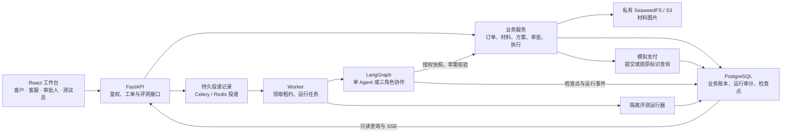

# 售后协作台架构

项目以模拟订单、库存和款项运行售后流程。客户提供诉求和材料，助手读取授权范围内的业务事实并给出说明或结构化草案。客服提交正式方案，独立审批人决定是否批准，客服再发起模拟执行。页面根据持久化记录展示进度与回执。[运行方式](OPERATIONS.md) · [当前验收范围](REQUIREMENTS_AUDIT_CURRENT.md)

## 入口与模块

| 模块 | 当前职责 |
| --- | --- |
| 工作台 | React、TypeScript 和 Ant Design。客户查看本人订单、描述问题、确认建单和补证。客服处理材料、查看助手运行并办理方案。审批人核对方案，测试员使用评测中台。页面根据角色呈现操作，API 对每个请求重新鉴权。 |
| API 与身份 | FastAPI 接收访问凭据，从持久化用户记录取得角色和客户身份。客户的订单与工单按归属校验，内部角色按各自操作权限读取或办理工单。自然语言入口先给出订单及意图预览，待客户确认后才建单。 |
| 业务服务 | 以订单行、材料版本、事实和有效政策计算资格、额度与库存。写入通过角色、版本和幂等校验，业务记录及状态事件持久化到 PostgreSQL。 |
| 智能协作 | LangGraph 编排前置规则、检索、模型工具调用、草案校验和补证恢复。模型工具只读，模型适配层记录实际尝试、用量、估算费用和错误。 |
| 评测 | 测试员可查看用例、实验和逐案证据。实验运行及报告导入使用测试环境。运行器在隔离数据上回放输入事件，评分参考留在评测侧，业务和模型以应用快照为准。 |

默认 Compose 使用离线规则和词法检索。体验环境可显式启用真实模型和本地向量检索。体验与测试各有独立数据库、Redis 队列和对象存储。材料正文保存在私有桶，业务库保存类型、版本、摘要及对象关联。授权预览由 API 校验归属、读取对象并核对完整性，短期签名链接使用部署配置的可达地址。[部署配置](OPERATIONS.md) · [API 装配](../backend/src/aftercare/api.py) · [材料存储](../backend/src/aftercare/business/storage.py)

## 助手运行与恢复

- 单 Agent 汇总只读工具结果、政策证据和业务校验。三 Agent 路径依次进行任务协调、政策查证和方案核验，受限返工后仍有冲突则转人工。两条路径共享确定性前置检查和草案校验。已知缺照片或待材料审核时，图先进入 `WAITING_INPUT`，对应原因及缺项随运行记录返回。
- 政策解析按意图、商品范围、时间和版本生成业务快照。检索使用 BM25，可选本地 BGE、pgvector 和 RRF 混合检索。向量索引不完整时保留词法结果及索引状态。候选条款、匹配原文、程序核对的适用前提和独立人工复核各自展示。
- 每案最多有一个活动运行，活动状态为 `QUEUED`、`RUNNING`、`WAITING_INPUT`。已完成、需人工、异常和取消分别记录为 `COMPLETED`、`NEEDS_REVIEW`、`FAILED`、`CANCELED`。人工补件或材料审核写入业务库后，用户提交继续请求。服务确认工单版本已前进，在原 run 和 thread 上递增 cycle，重新过前置规则。
- 同一 cycle 的 Worker 重启沿用 PostgreSQL LangGraph 检查点。进入图前，服务按本轮授权快照写入带版本的 `context_binding` 摘要。恢复时核对同周期绑定，已存在持久工作的周期缺绑定或摘要变化时转人工。已有成功调用结果复用前重新通过当前响应校验。运行发布前还会重读业务快照，发现漂移则保留原因并转人工。复核后可主动发起新一轮运行。
- 模型流式片段作为临时预览。运行面板区分草稿片段、已提交的运行输出和业务记录。运行事件按 run 内序号持久化，授权 SSE 支持游标补读，活动连接持续核对访问身份。工单事件有独立序号。页面用事件提示刷新事实，重连只读取记录。

[图及只读工具](../backend/src/aftercare/intelligence/graph.py) · [运行与周期绑定](../backend/src/aftercare/intelligence/service.py) · [政策检索](../backend/src/aftercare/intelligence/policies.py) · [运行事件接口](../backend/src/aftercare/intelligence/api.py) · [页面运行面板](../frontend/src/RunPanel.tsx)

## 共享内核与会话调查

`backend/src/aftercare/agent_kernel/` 是评测适配器和产品共用的部分：边界契约、程序护栏（零售评测用）、独立审查和按需专家。它不导入业务服务，也不导入官方评测库。

会话调查图的 `kernel` 路径（配置项 `chat_investigation_kernel_review`，默认关闭）在强单调查阶段之后增加一次独立审查：审查者只看到客户陈述和调查者读取过的记录，对“将发布的结论”给出放行或修改建议；修改最多一次，之后仍须通过原有的业务规则校验。审查结论记入运行输出和审计事件，不改变候选快照结构，也不改变客服审核、客户确认、审批和执行。复杂案继续走原有的事实/政策/核验路径。

`intelligence/graph.py` 的协调/政策/核验三角色图是遗留路径，只服务旧工单工作台。细节见 [产品接入记录](REFACTOR_PRODUCT_INTEGRATION.md)。

## 业务状态与写入权限

| 记录 | 状态和作用 |
| --- | --- |
| 工单 | `OPEN` 建单，`WAITING_INPUT` 补证，`HUMAN_REVIEW` 人工处理，`PROPOSED` 等待审批，`APPROVED` 或 `REJECTED` 记录决定。`EXECUTION_PENDING`、`EXECUTION_FAILED`、`RESOLVED` 反映执行状态。资格结果另行计算，可提交方案时返回 `ELIGIBLE`。 |
| 材料审核 | 客户或客服上传材料。客服的审核决定绑定当时的材料版本及材料集合。补充新材料形成新版本，旧意见保留供查阅。 |
| 方案与审批 | 客服提交确定性规则允许的退款或换货方案。方案绑定订单、材料、事实和政策快照，并记录版本及内容摘要。独立审批人对该方案批准或拒绝。批准有效期为 15 分钟，相关快照变化会使旧授权失效。部分退款还需要符合当前版本的处置决定。 |
| 执行账本 | 客服发起模拟执行，服务再次校验当前授权、内容摘要、适用事实及可用额度。每案最多一条执行账本，状态为 `SUBMITTING`、`UNKNOWN`、`SUCCEEDED`、`FAILED`。换货成功记录模拟库存回执，退款成功记录模拟款项回执。 |

助手的校验入口只读，草案可以带入客服表单。客服确认后才会创建正式方案。财务审批和模拟执行各由独立业务命令办理，图的中断点用于补材料或等待材料审核。[业务服务](../backend/src/aftercare/business/service.py) · [业务表](../backend/src/aftercare/business/models.py) · [方案与回执页面](../frontend/src/CaseProcessing.tsx)

## 任务租约、模拟执行和核对

**助手与评测任务。** API 先提交运行或实验记录，Celery 经 Redis 投递唤醒 Worker。PostgreSQL 投递账本按任务种类、目标及代次去重，Agent 任务代次对应 cycle。Worker 领取并续租，检查点和运行状态写入受租约围栏保护。定期恢复任务补发可运行目标，旧代次投递不能重新打开终态。任务租约保护的是助手或评测运行。[队列配置](../backend/src/aftercare/queue.py) · [投递记录与租约](../backend/src/aftercare/dispatch.py) · [Worker 入口](../backend/src/aftercare/queue_delivery.py)

**模拟退款。** 业务服务在锁定订单的事务里验证方案与批准，创建唯一执行记录并占用退款额度，先以 `SUBMITTING` 提交事务。只有创建该记录的调用会接着向模拟支付适配器提交。适配器在独立事务用业务键保存模拟支付结果。重复执行同一方案读取原账本，跨工单同类型且重叠订单行的执行由业务规则拦截。

**未知结果。** 模拟调用超时或回执无法验证时保留 `UNKNOWN`，进程中断也可能留下 `SUBMITTING`。两种状态继续占用对应额度。客服在原记录发起「核对执行结果」，服务用原业务键、内容摘要和金额查询模拟支付记录。核对确认成功时，在本地事务同时写入回执并更新订单行已退款额。确认失败时结束占用，查不到可信结果时继续待核对。退款进度查询可以读取同订单其他工单的退款执行记录，历史累计登记金额另列。[执行和核对实现](../backend/src/aftercare/business/service.py) · [本地模拟支付](../backend/src/aftercare/business/payment.py)

## 持久证据与验收边界

- **业务账本**用于确认方案、审批、库存或模拟退款结果。**运行审计**记录图输出、工具事件和模型尝试。**图检查点**保存 thread 执行位置。三者通过工单及运行标识关联，各自保留自己的状态。
- 评测冻结输入、配置和执行快照。结果保留失败、超时、未运行和待复核。补充用量审计单独读取晚到证据，原费用指标、结果和门槛仍按冻结记录展示。发布状态根据技术门槛显示「待独立审批」或「暂不可发布」。[评测服务](../backend/src/aftercare/evaluation/service.py) · [评测运行器](../backend/src/aftercare/evaluation/runner.py)
- 真实浏览器已有一次客服提交、独立审批人批准、客服执行并查看模拟回执的证据。真实 PostgreSQL 与 Worker 强杀报告验证了其各自的恢复场景。受控接口、模型替身和程序检查按各自范围记录。正式质量验收以独立人工金标及匹配的留出集证据为准。[浏览器财务闭环](../reports/browser-financial-flow.json) · [Worker 恢复](../reports/worker-crash.json) · [需求与证据审计](REQUIREMENTS_AUDIT_CURRENT.md)
